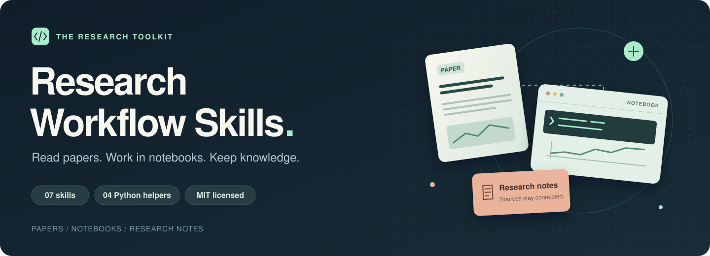
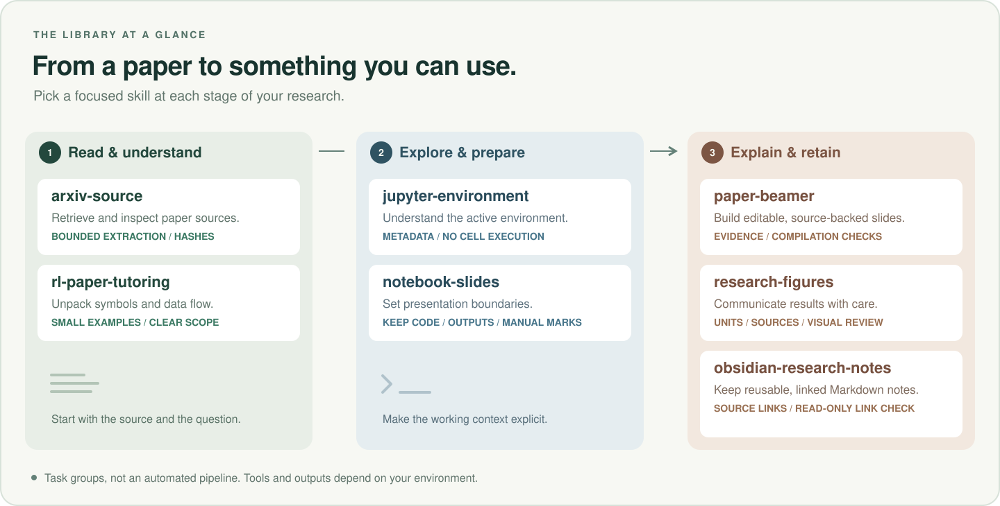

# Research Workflow Skills



[](https://github.com/oye-Li-bc/research-workflow-skills/actions/workflows/checks.yml)
[](https://github.com/oye-Li-bc/research-workflow-skills/releases/latest)
[](LICENSE)

面向论文阅读、课程 Notebook 和研究笔记的可维护技能库。
从实际 Work/Hermes 工作流提炼，使用通用 `SKILL.md` 入口，附独立脚本、
来源说明、离线测试和人工评估案例。

**[浏览技能](#技能) · [快速开始](#快速检查) · [安装与使用](#使用到-codex--hermes) · [下载版本](https://github.com/oye-Li-bc/research-workflow-skills/releases/latest) · [English](#english)**

## 一眼看懂

<picture>
  <source media="(max-width: 600px)" srcset="docs/assets/workflow-map-mobile.svg">
  
</picture>

- **读论文**：提取来源、理解 RL/VLA 的符号与数据流。
- **整理 Notebook**：检查环境信息、设置演示边界，保留已有代码和输出。
- **沉淀研究成果**：制作 Beamer、绘制研究图表、整理带来源的 Markdown 笔记。

这些技能可按任务独立选用。图中连线表示研究阶段之间的关系，具体工具要求和
验证范围见各技能说明及[兼容性文档](docs/compatibility.md)。

## 技能

| 技能 | 用途 | 附带脚本 |
|---|---|---|
| [arxiv-source](skills/arxiv-source/SKILL.md) | 获取/解包论文源码，区分 PDF-only 响应 | 有界解包、来源哈希 |
| [paper-beamer](skills/paper-beamer/SKILL.md) | 论文到可编辑 Beamer，保留论据与验证边界 | 论据提纲 |
| [jupyter-environment](skills/jupyter-environment/SKILL.md) | 识别界面、内核、包与扩展错配 | 无执行的环境诊断 |
| [notebook-slides](skills/notebook-slides/SKILL.md) | 按标题/单元格设幻灯片边界 | 保留代码、输出和手动标记 |
| [obsidian-research-notes](skills/obsidian-research-notes/SKILL.md) | 有来源、路径明确的 Markdown 笔记 | 只读 wikilink 检查 |
| [rl-paper-tutoring](skills/rl-paper-tutoring/SKILL.md) | 针对具体 RL/VLA 段落讲清符号与数据流 | 指令型 |
| [research-figures](skills/research-figures/SKILL.md) | 有单位、来源与视觉检查的研究图表 | 指令型 |

## 快速检查

管理工具和脚本只需要 Python 3.11+，离线检查无需 API key：

```sh
python tools/skillctl.py validate
python -m unittest discover -s tests -v
python tools/skillctl.py catalog
python tools/skillctl.py build
```

生成 `dist/research-workflow-skills-v0.1.0.zip` 和 `dist/SHA256SUMS`。
脚本测试使用合成输入；测试不会执行 Notebook、访问真实 vault 或联网抓论文。

## 使用到 Codex / Hermes

选择你自己的技能目录。每个技能是一个可独立复制的文件夹；先预览：

```sh
python tools/skillctl.py install --destination ./my-skills --skill arxiv-source --dry-run
python tools/skillctl.py install --destination ./my-skills --skill arxiv-source
```

省略 `--skill` 安装全部；重复该参数可以选择多个。安装器拒绝覆盖已有技能。
Codex 通常使用用户的 `.codex/skills` 或项目技能目录；Hermes 使用相应
profile 的 skills 目录。按你的实际配置选择绝对目标，不要照抄别人的路径。
详见 [兼容性](docs/compatibility.md)。

在 agent 中请求相关任务，或显式提及技能名称。脚本路径相对于技能文件夹；
在 agent 自动执行任何脚本前，应先理解其输出和环境要求。

## 验证范围

- CI 检查入口字段、目录/索引一致性、本地引用、Python 语法和离线回归。
- 发布包使用固定 ZIP 时间戳，并提供 SHA-256。相同输入在相同 Python/zlib
  环境下应产生相同字节；不同压缩库版本的包可能具有不同哈希。
- [14 个 agent 行为案例](evals/cases.json)覆盖正例与边界。它们是待执行的
  人工评估，不计入脚本测试通过数。
- 尚未验证 Codex/Hermes 全部版本的自动发现、真实网络下载、Beamer 编译或
  每个技能的端到端效果。具体 host/tool 可用性由运行环境决定。

## 持续维护

有真实使用失败时，记录最小复现 → 修正相关技能/脚本 → 加回归或行为案例 →
检查通过 → 更新版本和发布说明。见 [维护流程](docs/maintenance.md) 和
[贡献指南](CONTRIBUTING.md)。目前不宣称外部采用量或效果提升。

## 来源与许可

[MIT](LICENSE) 适用于本仓库的新编内容。每个技能的工作流来源记录在
[catalog.json](catalog.json)，再分发边界见 [NOTICE.md](NOTICE.md)。
本项目不包含已安装的第三方技能全集、论文资源、个人配置或会话日志。
首页插图为仓库内原创 SVG，使用系统字体，不依赖外部图片服务；可直接编辑，
亦适用本仓库 MIT 许可。见[图片说明](docs/assets/README.md)。

## English

A small research-workflow skill library distilled from real Work and Hermes
customizations. It provides portable skill folders, four standard-library helpers,
offline regression tests, explicit provenance, and an unexecuted agent-evaluation
suite. Instructions and helper correctness are evaluated separately. See the
linked skill files for English operational guidance and verification boundaries.
